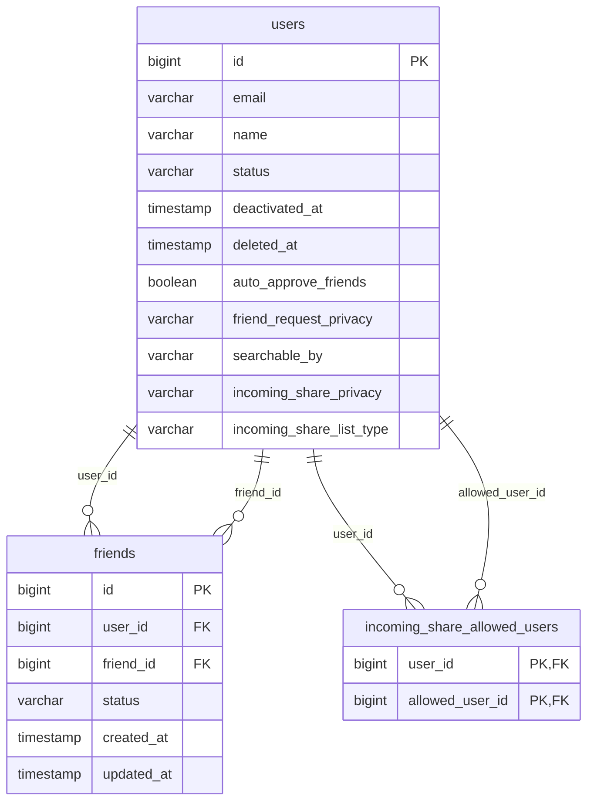
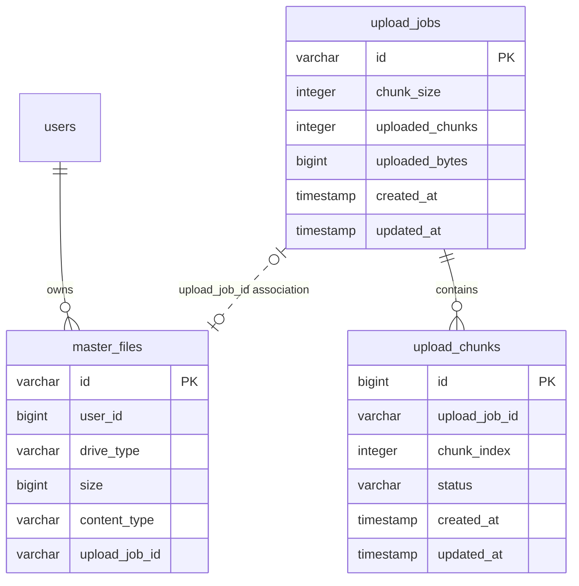
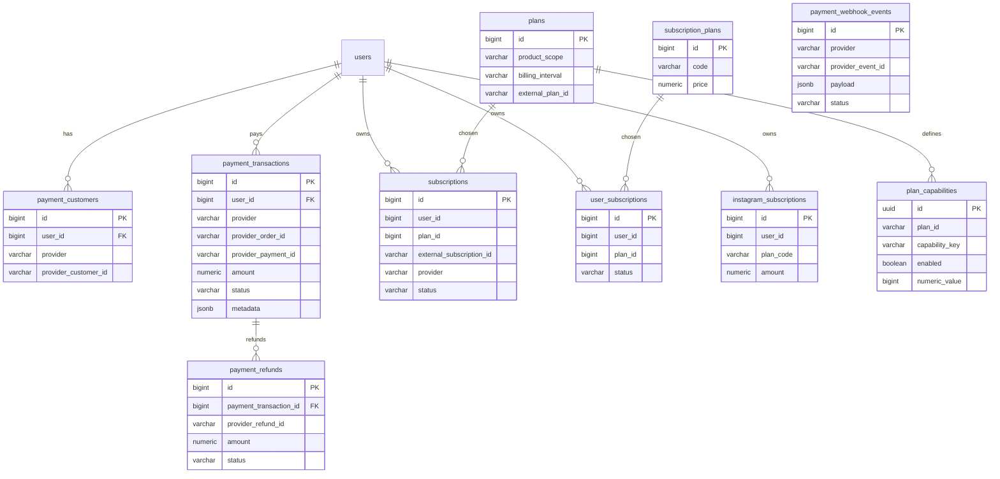
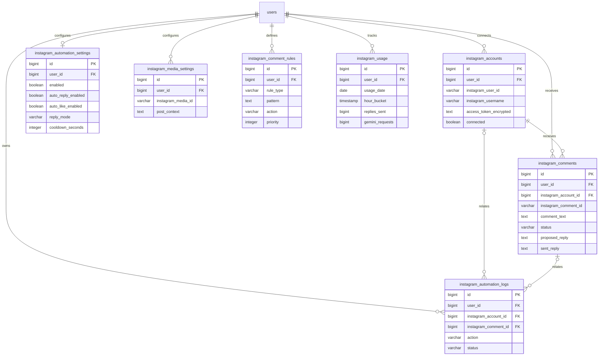
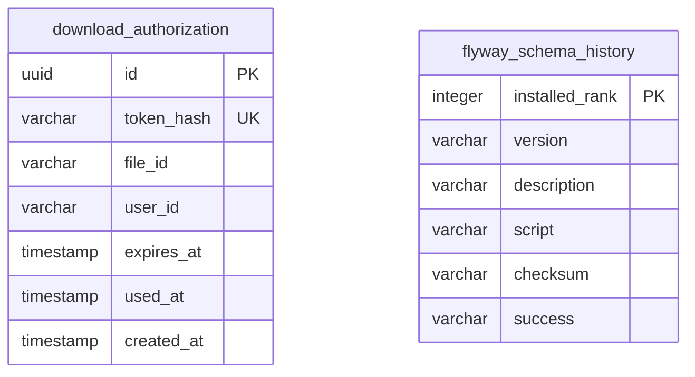

# FileServer — Visual Database Map

> Source: Flyway migrations currently present on `feature/chunked-file-transfer` (through V1.0.14) and the repository's known PostgreSQL table inventory. This is a **schema-level documentation map**, not a live introspection of a running database. Confirm inferred/unconstrained links against the deployed PostgreSQL catalog before treating them as enforced foreign keys.

## 1. Database at a glance

The database is PostgreSQL. Tables are grouped into these domains:

| Domain | Tables |
|---|---|
| Identity & privacy | `users`, `friends`, `incoming_share_allowed_users` |
| Drive & file metadata | `master_files` |
| Chunked transfer | `upload_jobs`, `upload_chunks` |
| Billing & entitlements | `plans`, `subscriptions`, `plan_capabilities`, `payment_customers`, `payment_transactions`, `payment_refunds`, `payment_webhook_events`, `subscription_plans`, `user_subscriptions`, `instagram_subscriptions` |
| Instagram automation | `instagram_accounts`, `instagram_automation_settings`, `instagram_media_settings`, `instagram_comment_rules`, `instagram_comments`, `instagram_automation_logs`, `instagram_usage` |
| Secure download | `download_authorization` |
| Schema versioning | `flyway_schema_history` |

## 2. Full logical ER diagram

Solid relationship lines below represent relationships declared by the migration SQL. Dashed lines represent logical/application associations or relationships whose FK constraint is not declared in the migrations inspected.

```mermaid
erDiagram
    users ||--o{ friends : "user_id"
    users ||--o{ friends : "friend_id"
    users ||--o{ incoming_share_allowed_users : "owner user_id"
    users ||--o{ incoming_share_allowed_users : "allowed_user_id"

    users ||--o{ instagram_accounts : owns
    users ||--o| instagram_automation_settings : configures
    users ||--o{ instagram_media_settings : configures
    users ||--o{ instagram_comment_rules : defines
    users ||--o{ instagram_comments : receives
    users ||--o{ instagram_automation_logs : generates
    users ||--o{ instagram_usage : consumes
    instagram_accounts ||--o{ instagram_comments : receives
    instagram_accounts o|--o{ instagram_automation_logs : logs
    instagram_comments o|--o{ instagram_automation_logs : processed_as

    users ||--o{ payment_customers : has
    users ||--o{ payment_transactions : makes
    payment_transactions ||--o{ payment_refunds : refunded_by
    users ||--o{ subscriptions : subscribes
    plans ||--o{ subscriptions : selected_plan
    users ||--o{ user_subscriptions : has
    subscription_plans ||--o{ user_subscriptions : selected_plan
    users ||--o{ instagram_subscriptions : purchases

    plans ||--o{ plan_capabilities : capabilities

    upload_jobs ||--o{ upload_chunks : contains
    users ||--o{ master_files : owns
    master_files o|..o| upload_jobs : "upload_job_id (logical)"
    users ||--o{ download_authorization : authorizes

    users {
      bigint id PK
    }
    friends {
      bigint id PK
      bigint user_id FK
      bigint friend_id FK
      varchar status
    }
    incoming_share_allowed_users {
      bigint user_id PK,FK
      bigint allowed_user_id PK,FK
    }
    master_files {
      varchar id PK
      bigint user_id
      varchar upload_job_id
    }
    upload_jobs {
      varchar id PK
      integer chunk_size
      bigint uploaded_bytes
      integer uploaded_chunks
    }
    upload_chunks {
      bigint id PK
      varchar upload_job_id FK
      integer chunk_index
      varchar status
    }
    plans {
      bigint id PK
      varchar product_scope
      varchar billing_interval
    }
    subscriptions {
      bigint id PK
      bigint user_id
      bigint plan_id
      varchar external_subscription_id
      varchar status
    }
    plan_capabilities {
      uuid id PK
      varchar plan_id
      varchar capability_key
    }
    payment_customers {
      bigint id PK
      bigint user_id FK
      varchar provider
      varchar provider_customer_id
    }
    payment_transactions {
      bigint id PK
      bigint user_id FK
      varchar provider_payment_id
      numeric amount
    }
    payment_refunds {
      bigint id PK
      bigint payment_transaction_id FK
      numeric amount
    }
    payment_webhook_events {
      bigint id PK
      varchar provider
      varchar provider_event_id
    }
    subscription_plans {
      bigint id PK
      varchar code
      numeric price
    }
    user_subscriptions {
      bigint id PK
      bigint user_id
      bigint plan_id
      varchar status
    }
    instagram_subscriptions {
      bigint id PK
      bigint user_id
      varchar plan_code
      numeric amount
    }
    instagram_accounts {
      bigint id PK
      bigint user_id FK
      varchar instagram_user_id
    }
    instagram_automation_settings {
      bigint id PK
      bigint user_id FK
      boolean enabled
    }
    instagram_media_settings {
      bigint id PK
      bigint user_id FK
      varchar instagram_media_id
    }
    instagram_comment_rules {
      bigint id PK
      bigint user_id FK
      varchar rule_type
    }
    instagram_comments {
      bigint id PK
      bigint user_id FK
      bigint instagram_account_id FK
      varchar instagram_comment_id
    }
    instagram_automation_logs {
      bigint id PK
      bigint user_id FK
      bigint instagram_account_id FK
      bigint instagram_comment_id FK
    }
    instagram_usage {
      bigint id PK
      bigint user_id FK
      date usage_date
      timestamp hour_bucket
    }
    download_authorization {
      uuid id PK
      varchar token_hash
      varchar file_id
      varchar user_id
    }
```



## 3. Identity, friends & privacy



- `users.email` is unique according to the migration notes.
- `friends` has a unique pair constraint on `(user_id, friend_id)`.
- `incoming_share_allowed_users` is a two-user join table with a composite primary key.
- Privacy/status values are stored as strings; allowed enum values are defined by application code.

## 4. Drive & chunked file transfer



- The migrations add `master_files.upload_job_id` and an index; they do not declare it as a database FK.
- `upload_chunks` is protected against duplicate logical chunks by uniqueness on `(upload_job_id, chunk_index)` (the migrations add a named constraint and a unique index).
- Telegram file identifiers / chunk storage references are metadata; the binary payload itself is stored externally in Telegram, not in PostgreSQL.

## 5. Billing, payments & plans



**Important:** The repository contains both the newer `plans/subscriptions` model and the additional `subscription_plans/user_subscriptions` tables. Treat them as separate models until application entity/service usage confirms whether one is legacy or still active. `plan_capabilities.plan_id` is a string and is not declared as a foreign key in the migration. The webhook event table is idempotent by unique `(provider, provider_event_id)`.

## 6. Instagram automation



The Instagram migrations explicitly create FKs to `users`, and comments/logs also link to `instagram_accounts` / `instagram_comments`. Media settings and rules are associated to users; matching a comment's `instagram_media_id` to a media-settings row is an application-level lookup, not a declared FK.

## 7. Secure download & platform metadata



- `download_authorization.file_id` and `user_id` are not declared as foreign keys in V1.0.14.
- `flyway_schema_history` is managed by Flyway and records applied schema migrations.

## 8. Run this against PostgreSQL to get the exact live schema

The migration diagrams above are based on source-controlled SQL. To produce the authoritative live diagram, run the following read-only SQL against the same database your application uses. It returns every public table, column, type, nullability, and PK/FK/unique constraint.

```sql
SELECT
    c.table_name,
    c.ordinal_position,
    c.column_name,
    c.data_type,
    c.udt_name,
    c.is_nullable,
    c.column_default,
    CASE
        WHEN tc.constraint_type = 'PRIMARY KEY' THEN 'PK'
        WHEN tc.constraint_type = 'FOREIGN KEY' THEN 'FK'
        WHEN tc.constraint_type = 'UNIQUE' THEN 'UK'
        ELSE ''
    END AS key_type,
    ccu.table_name AS referenced_table,
    ccu.column_name AS referenced_column
FROM information_schema.columns c
LEFT JOIN information_schema.key_column_usage kcu
    ON kcu.table_schema = c.table_schema
   AND kcu.table_name = c.table_name
   AND kcu.column_name = c.column_name
LEFT JOIN information_schema.table_constraints tc
    ON tc.constraint_schema = kcu.constraint_schema
   AND tc.constraint_name = kcu.constraint_name
   AND tc.table_name = kcu.table_name
LEFT JOIN information_schema.constraint_column_usage ccu
    ON ccu.constraint_schema = tc.constraint_schema
   AND ccu.constraint_name = tc.constraint_name
WHERE c.table_schema = 'public'
ORDER BY c.table_name, c.ordinal_position;
```

For a quick table inventory:

```sql
SELECT table_name
FROM information_schema.tables
WHERE table_schema = 'public'
  AND table_type = 'BASE TABLE'
ORDER BY table_name;
```

## 9. Caveats / items to verify

1. The core creation migrations for baseline tables such as `users`, `master_files`, `upload_jobs`, `upload_chunks`, `plans`, and `subscriptions` are not included in the migration directory snapshot inspected here. Their displayed columns are a useful logical overview, not a complete column inventory.
2. Some links (notably `master_files.upload_job_id`, billing user/plan links, `plan_capabilities.plan_id`, and download authorization references) are not enforced by FK constraints in the migrations shown.
3. Flyway's `flyway_schema_history` is infrastructure metadata, not application data.
4. PostgreSQL table names are case-sensitive only when quoted; these diagrams use the lower-case names used by the migrations.
